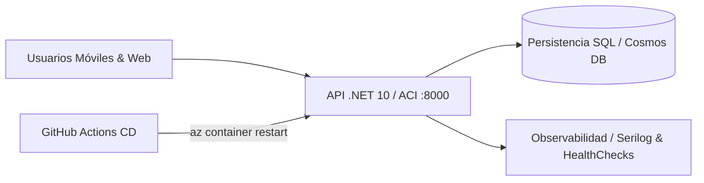

# Arquitectura de despliegue — BusTrack API

> **Estado:** Desplegado y verificado en Microsoft Azure (`rg-bustrack-ncus`).

## 1. Rol en BusTrack

La API central (`bustrack-api`) es el núcleo backend de orquestación, contratos REST y lógica de negocio para el ecosistema de movilidad BusTrack.

## 2. Topología en Azure

## 3. Recursos desplegados

| Recurso | Tipo de Servicio | FQDN / Endpoint | Estado |
|---|---|---|---|
| **bustrack-api** | Azure Container Instance (North Central US) | `http://bustrack-api-uttt.northcentralus.azurecontainer.io:8000` | 🟢 En línea (200 OK) |
| **bustrack-landing** | Azure Container Instance (North Central US) | `http://bustrack-landing-uttt.northcentralus.azurecontainer.io:8000` | 🟢 En línea (200 OK) |

## 4. Configuración y secretos

- Variables por entorno (`ConnectionStrings`, `Jwt`, `Serilog`).
- Sin credenciales duras en el código; auditoría bloqueante con Semgrep.
- Credenciales de despliegue resguardadas en GitHub Secrets (`AZURE_CREDENTIALS`).

## 5. Operación y monitoreo

- **Liveness probe:** `GET /health` responde `Healthy` (200 OK).
- **Readiness probe:** `GET /health/ready` valida conectividad de dependencias críticas con timeout acotado de 5s.
- **REST Ping:** `GET /api/v1/ping` responde `{"status":"Pong"}` con `X-Correlation-Id`.

## 6. Referencias

- Pipeline de CI/CD: `../cicd/` y `../.github/workflows/`.
- Memoria técnica detallada: `arquitectura.md`.
