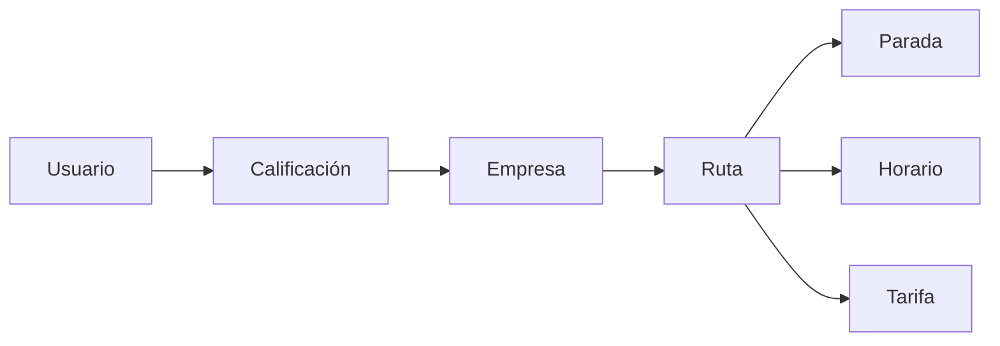
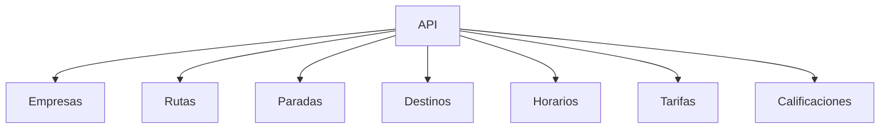
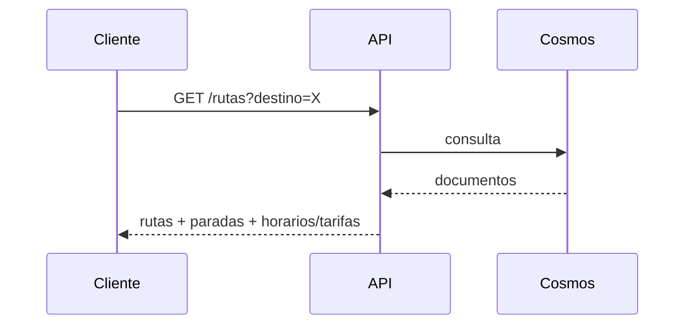

# Diagramas — Dominio de transporte (empresas, rutas, paradas, destinos, horarios, tarifas, calificaciones)

> Spec: `spec.md` · Plan: `plan.md`. Diagramas Mermaid; no representan recursos desplegados.

## 1. Flujo funcional

## 2. Relación entre componentes

## 3. Flujo de datos / secuencia

## 4. Notas

Ninguna entidad de transporte existe todavía en el código.
