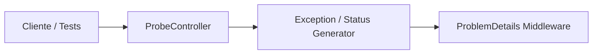
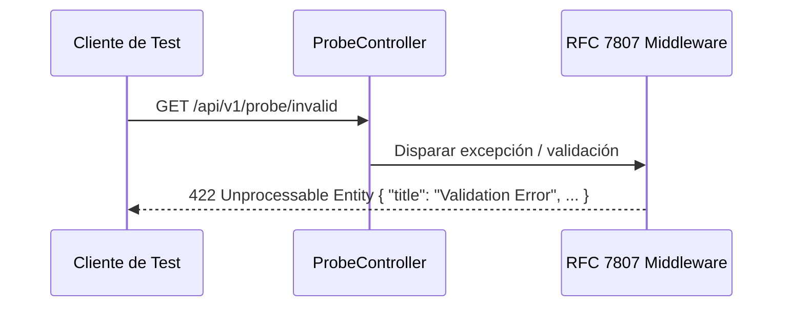

# Diagramas — 25-endpoint-probes — Endpoints de diagnóstico y sondeo de errores

> Spec: `spec.md` · Plan: `plan.md`.

## 1. Flujo del endpoint

```mermaid
flowchart TD
  A[GET /api/v1/probe/{tipo}] --> B{¿Es Producción?}
  B -->|Sí| C[404 Not Found]
  B -->|No| D{Tipo de sonda}
  D -->|timeout| E[408 Request Timeout]
  D -->|error| F[500 Internal Error]
  D -->|forbidden| G[403 Forbidden]
  D -->|conflict| H[409 Conflict]
  D -->|invalid| I[422 Unprocessable]
```

## 2. Componentes



## 3. Secuencia



## 4. Notas

Diagramas de proceso; no representan recursos desplegados.

