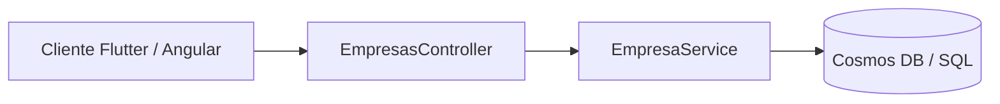
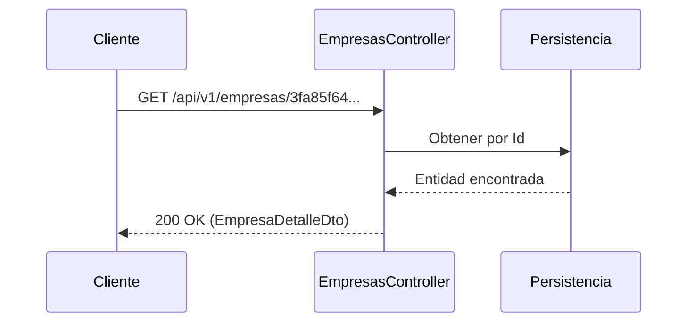

# Diagramas — 27-endpoint-empresa-individual — Endpoint de detalle de empresa de transporte

> Spec: `spec.md` · Plan: `plan.md`.

## 1. Flujo del endpoint

```mermaid
flowchart TD
  A[GET /api/v1/empresas/{id}] --> B{¿GUID válido?}
  B -->|No| C[400 Bad Request]
  B -->|Sí| D[Consultar servicio de empresas]
  D --> E{¿Existe empresa?}
  E -->|No| F[404 Not Found]
  E -->|Sí| G[Mapear EmpresaDetalleDto]
  G --> H[200 OK con JSON]
```

## 2. Componentes



## 3. Secuencia



## 4. Notas

Diagramas de proceso; no representan recursos desplegados.

