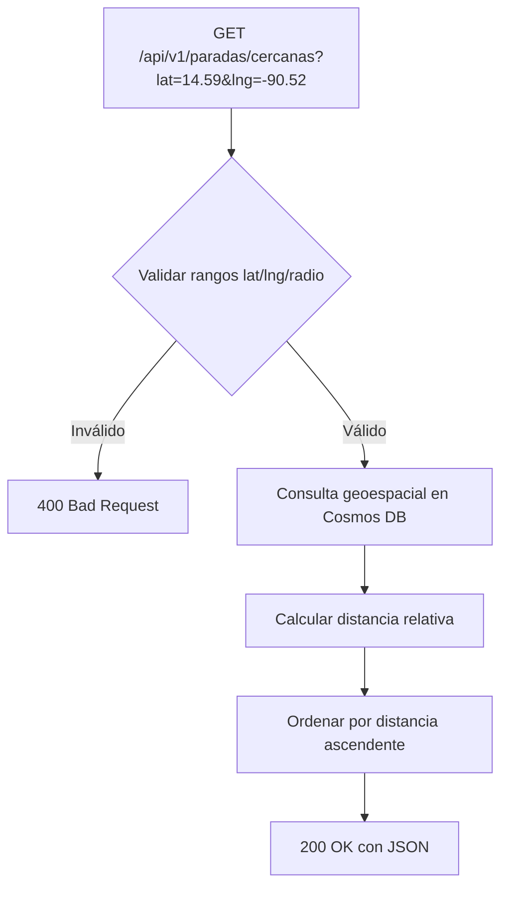
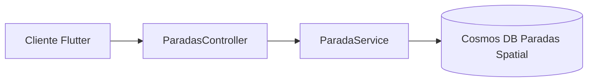
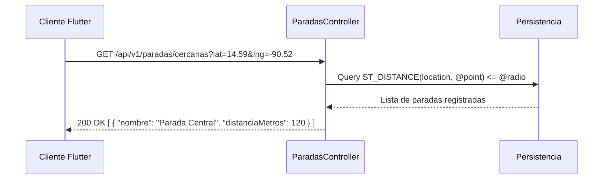

# Diagramas — 32-endpoint-parada-individual — Endpoint de detalle y cercanía de paradas

> Spec: `spec.md` · Plan: `plan.md`.

## 1. Flujo del endpoint

## 2. Componentes

## 3. Secuencia

## 4. Notas

Diagramas de proceso; no representan recursos desplegados.

