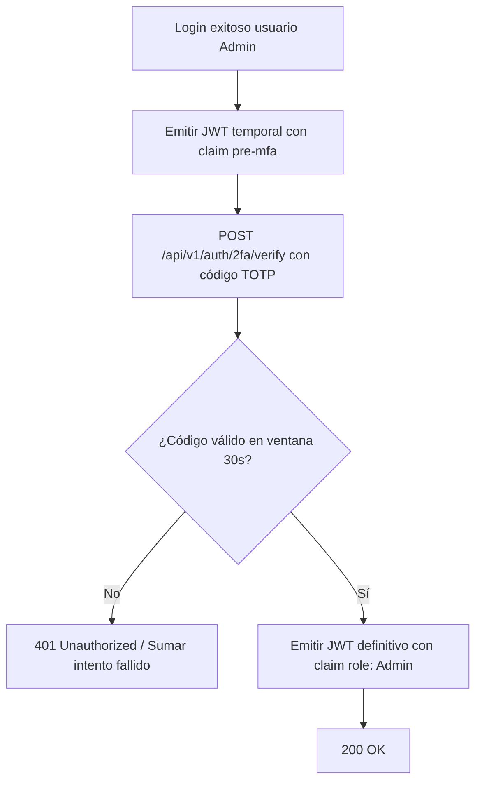
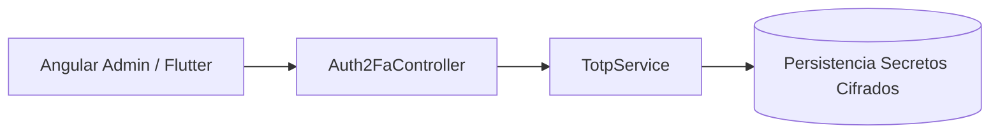
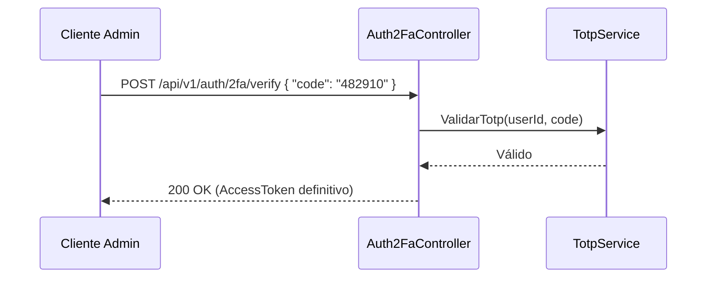

# Diagramas — 34-endpoint-auth-2fa — Endpoint de autenticación de dos factores (2FA / MFA)

> Spec: `spec.md` · Plan: `plan.md`.

## 1. Flujo del endpoint

## 2. Componentes

## 3. Secuencia

## 4. Notas

Diagramas de proceso; no representan recursos desplegados.

