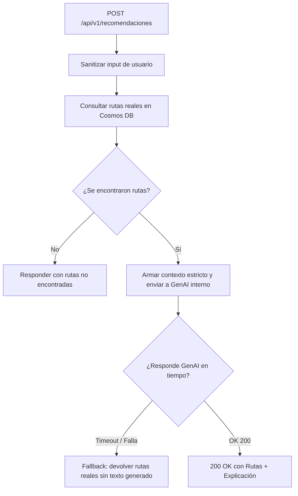
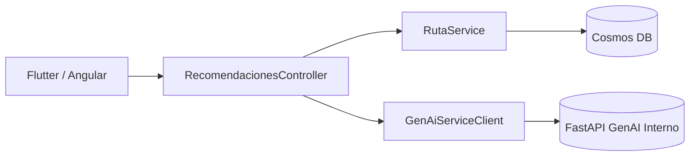
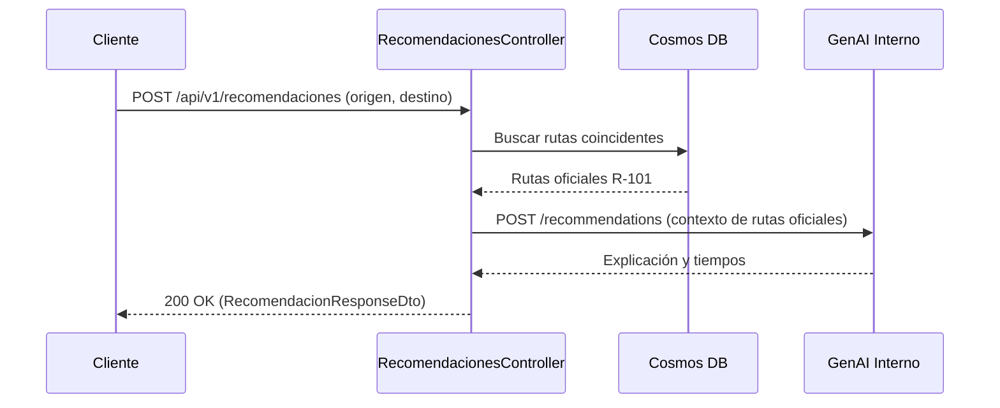

# Diagramas — 37-endpoint-genai-recomendaciones — Endpoint de recomendaciones y planificación de viajes (GenAI)

> Spec: `spec.md` · Plan: `plan.md`.

## 1. Flujo del endpoint

## 2. Componentes

## 3. Secuencia

## 4. Notas

Diagramas de proceso; no representan recursos desplegados.

