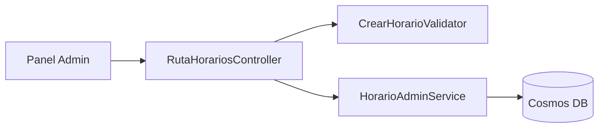
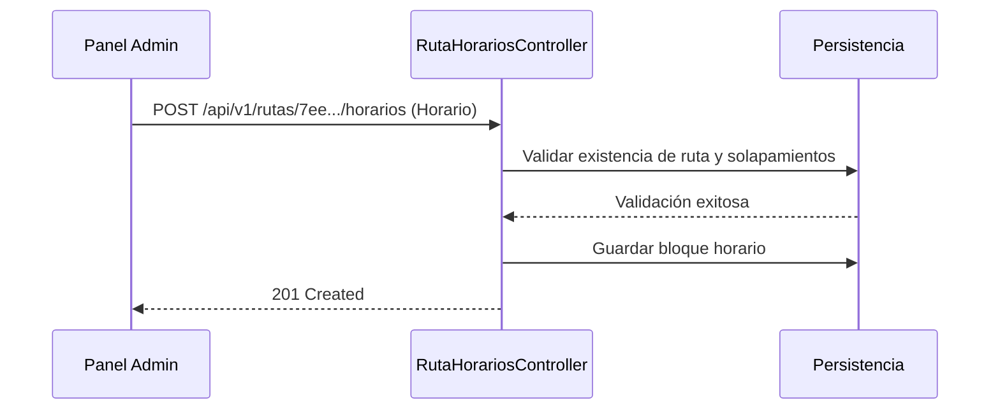

# Diagramas — 40-endpoint-admin-horarios-tarifas — Endpoint de administración de horarios y tarifas de ruta

> Spec: `spec.md` · Plan: `plan.md`.

## 1. Flujo del endpoint

```mermaid
flowchart TD
  A[POST /api/v1/rutas/{id}/horarios] --> B{¿AdminPolicy?}
  B -->|No| C[401 / 403 Error]
  B -->|Sí| D[Comprobar existencia de ruta]
  D -->|Ruta inexistente| E[404 Not Found]
  D -->|Existe| F{¿Hay solapamiento horario?}
  F -->|Sí| G[409 Conflict]
  F -->|No| H[Guardar horario]
  H --> I[201 Created]
```

## 2. Componentes



## 3. Secuencia



## 4. Notas

Diagramas de proceso; no representan recursos desplegados.

