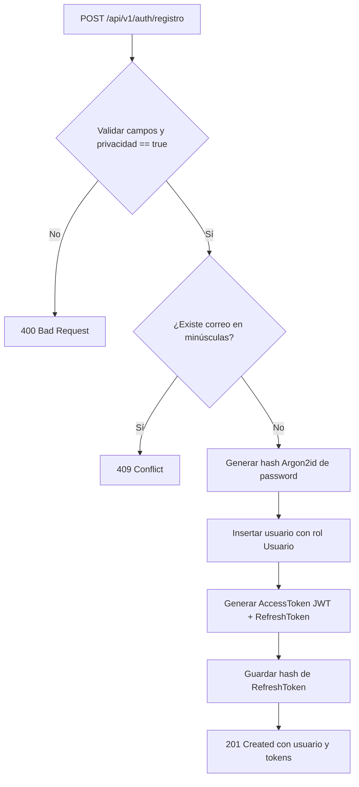
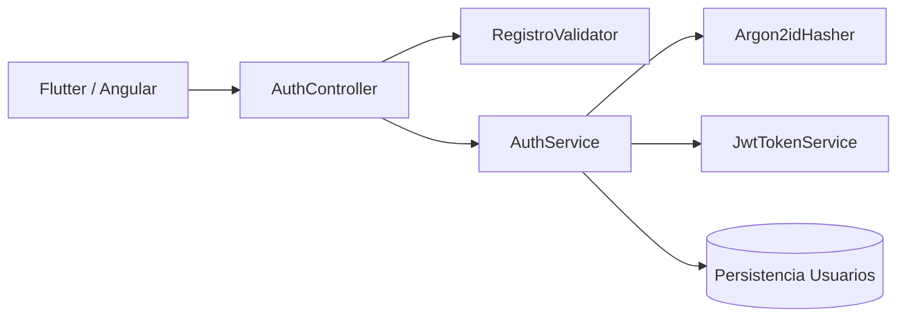
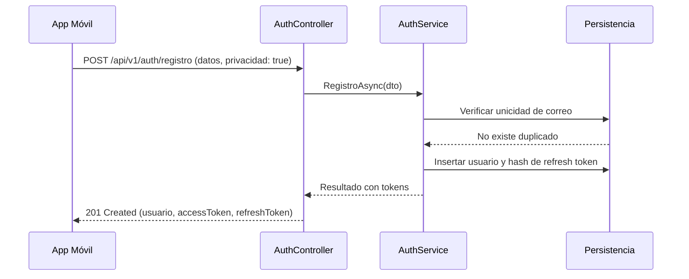

# Diagramas — 41-endpoint-auth-registro — Endpoint de registro de usuario (EP-AU-01)

> Spec: `spec.md` · Plan: `plan.md`.

## 1. Flujo del endpoint

## 2. Componentes

## 3. Secuencia

## 4. Notas

Diagramas de proceso; no representan recursos desplegados.
