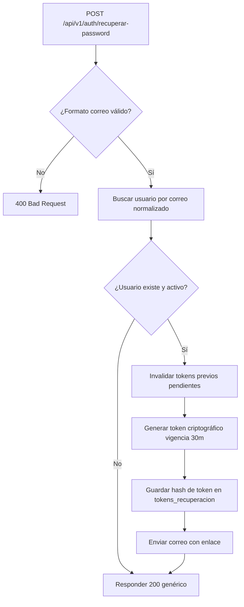
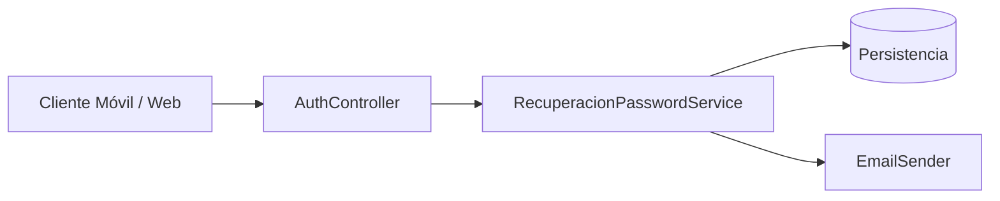
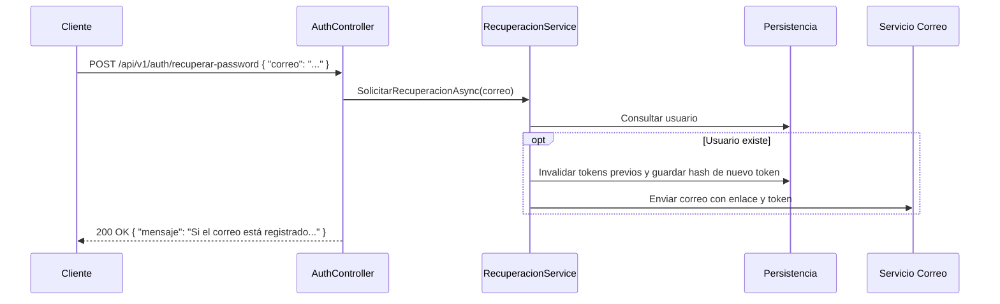

# Diagramas — 42-endpoint-auth-recuperar-password — Endpoint de solicitud de recuperación de contraseña (EP-AU-05)

> Spec: `spec.md` · Plan: `plan.md`.

## 1. Flujo del endpoint

## 2. Componentes

## 3. Secuencia

## 4. Notas

Diagramas de proceso; no representan recursos desplegados.
