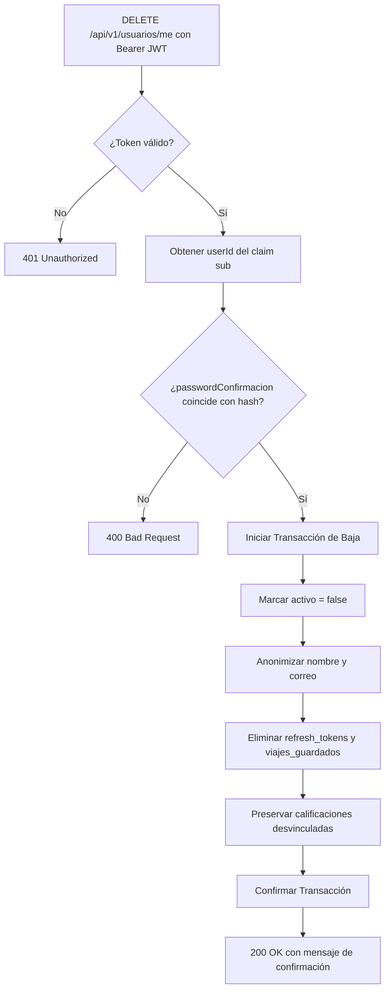
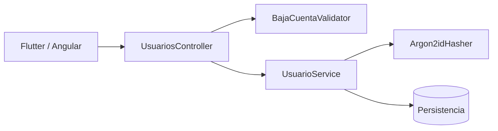
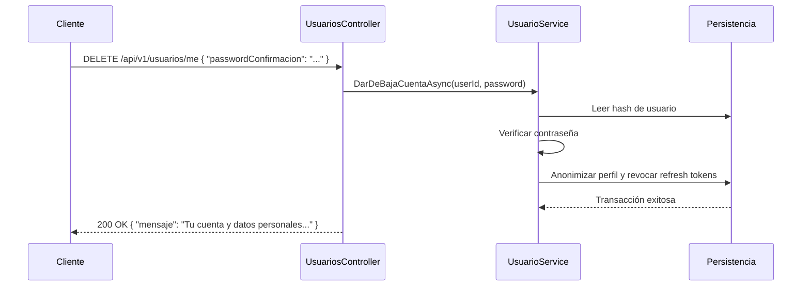

# Diagramas — 46-endpoint-usuario-perfil-baja — Endpoint de baja de cuenta de usuario autenticado (EP-AU-09)

> Spec: `spec.md` · Plan: `plan.md`.

## 1. Flujo del endpoint

## 2. Componentes

## 3. Secuencia

## 4. Notas

Diagramas de proceso; no representan recursos desplegados.
