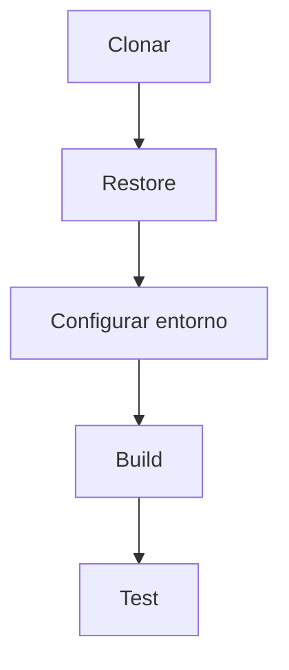
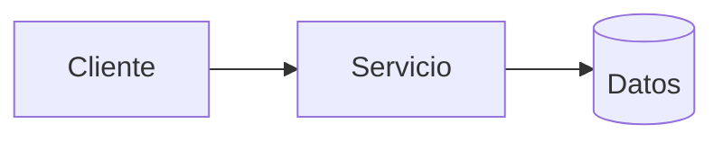
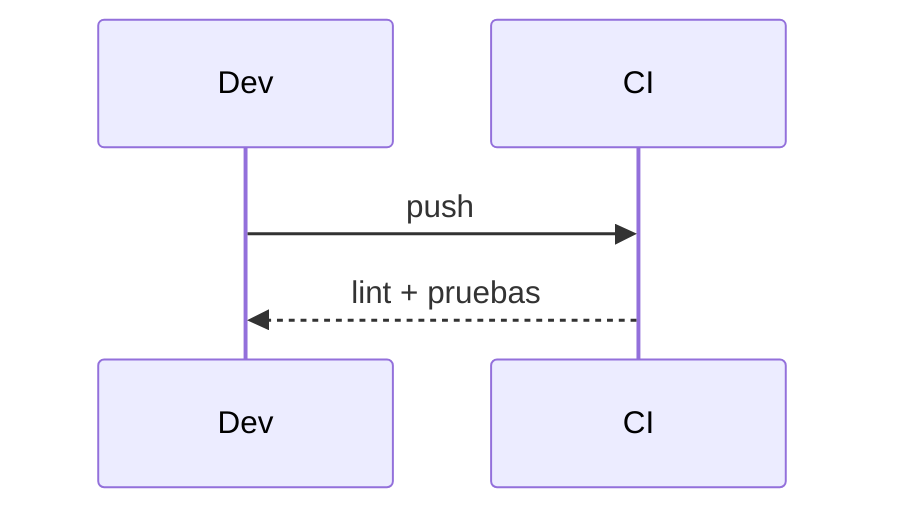

# Diagramas — 01-configuracion-inicial-del-proyecto — Configuración inicial del proyecto

> Spec: `spec.md` · Plan: `plan.md`.

## 1. Flujo funcional

## 2. Componentes

## 3. Secuencia

## 4. Notas

El build estándar está bloqueado por NuGetAudit; no se desactiva sin autorización.
