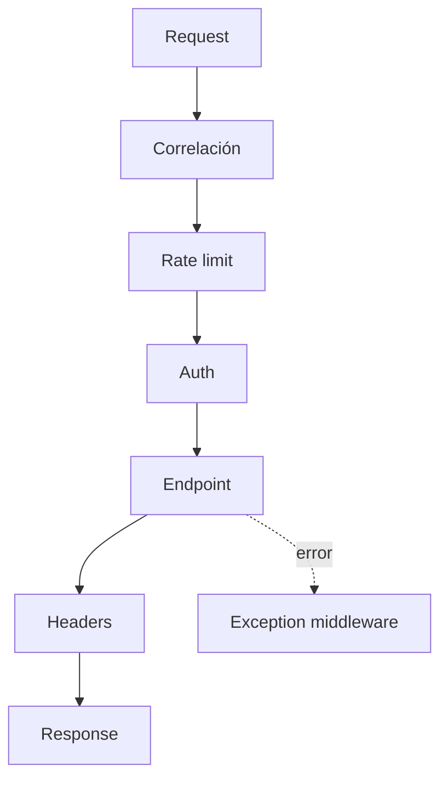
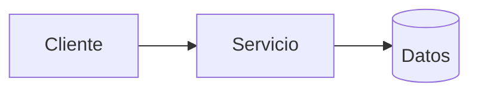
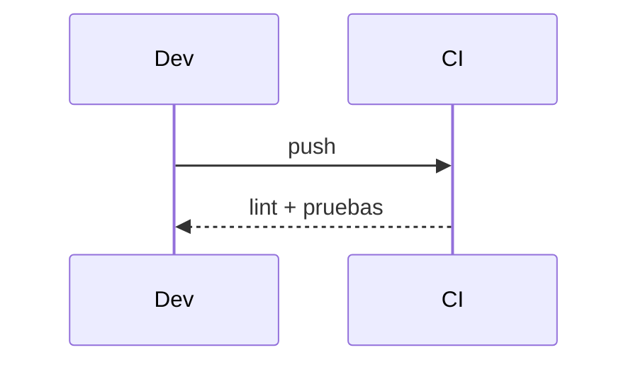

# Diagramas — 02-arquitectura-base-y-pipeline-http — Arquitectura base y pipeline HTTP

> Spec: `spec.md` · Plan: `plan.md`.

## 1. Flujo funcional

## 2. Componentes

## 3. Secuencia

## 4. Notas

Pipeline implementado; no implica despliegue.
