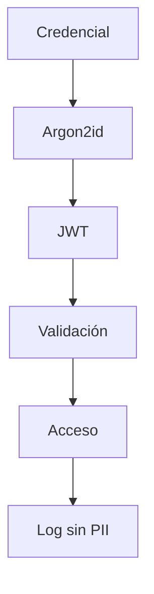
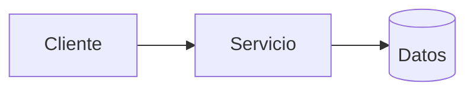
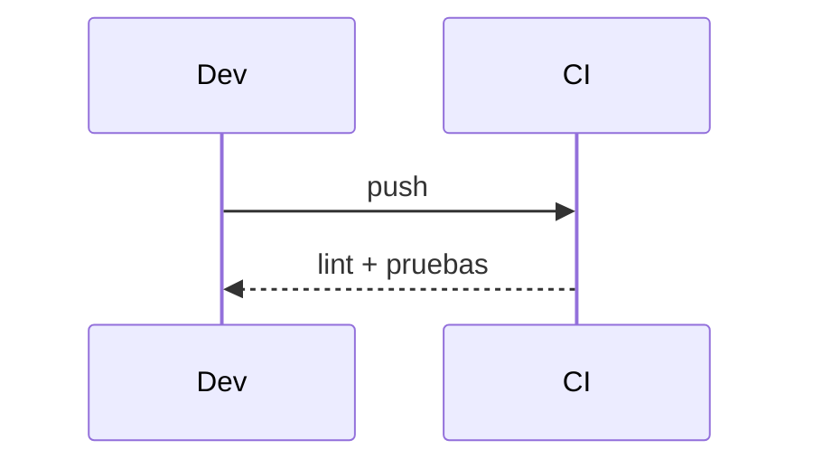

# Diagramas — 03-configuracion-de-seguridad — Configuración de seguridad

> Spec: `spec.md` · Plan: `plan.md`.

## 1. Flujo funcional

## 2. Componentes

## 3. Secuencia

## 4. Notas

Semgrep quedó como deuda hasta que las reglas se validen en CI.
