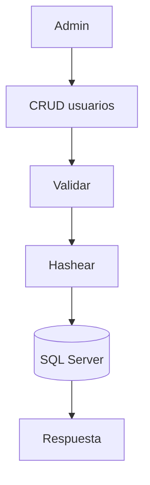
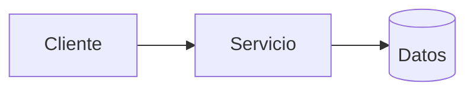
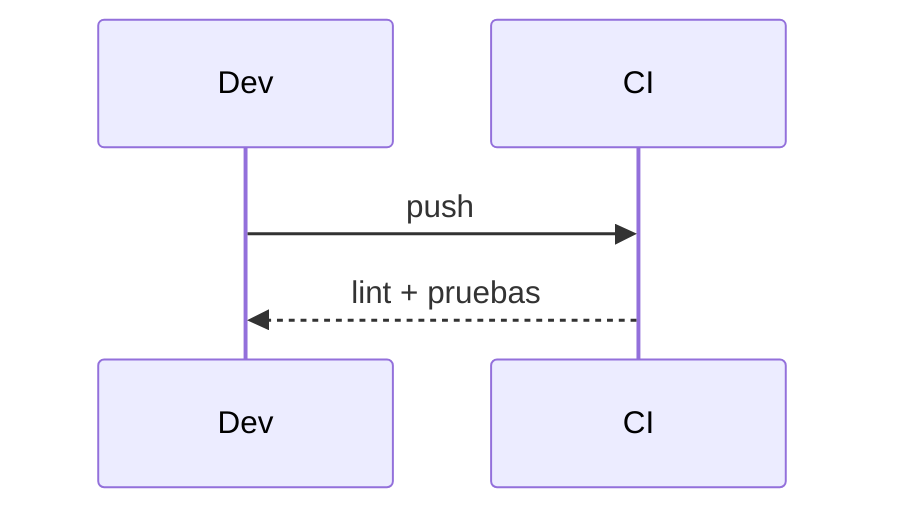

# Diagramas — 04-gestion-de-usuarios — Gestión de usuarios

> Spec: `spec.md` · Plan: `plan.md`.

## 1. Flujo funcional

## 2. Componentes

## 3. Secuencia

## 4. Notas

La persistencia cambiará a Cosmos DB en la tarea 12.
