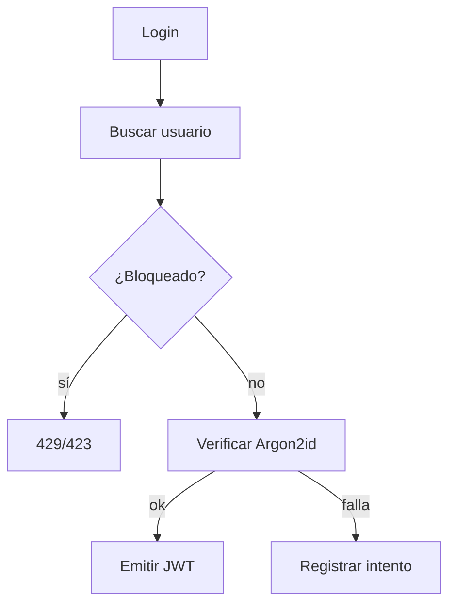
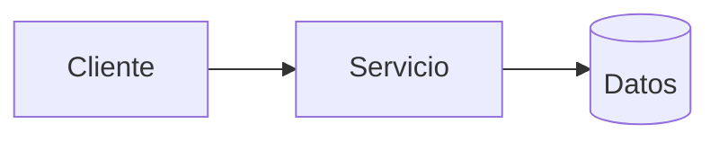
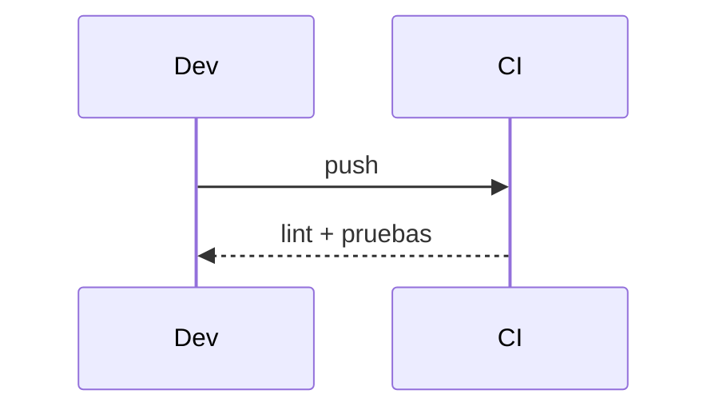

# Diagramas — 05-autenticacion-jwt — Autenticación con JWT

> Spec: `spec.md` · Plan: `plan.md`.

## 1. Flujo funcional

## 2. Componentes

## 3. Secuencia

## 4. Notas

JWT HS256; no hay refresh token ni 2FA.
