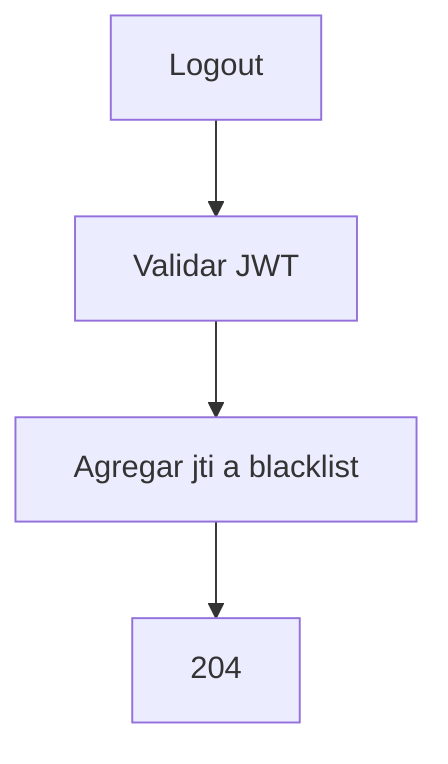
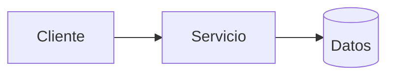
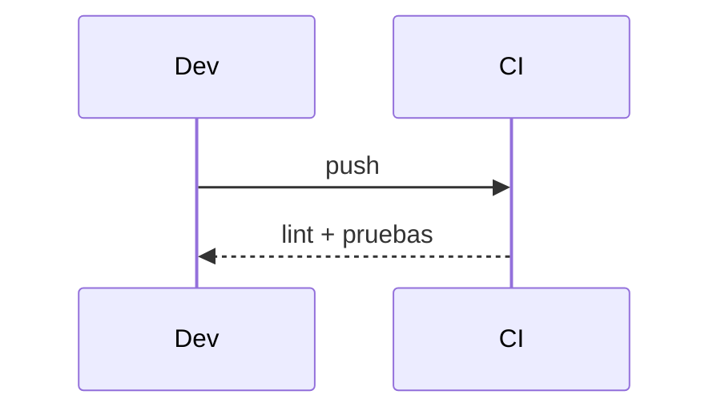

# Diagramas — 06-gestion-de-sesiones-y-logout — Gestión de sesiones y logout

> Spec: `spec.md` · Plan: `plan.md`.

## 1. Flujo funcional

## 2. Componentes

## 3. Secuencia

## 4. Notas

La blacklist en memoria es una limitación conocida; no hay Redis.
