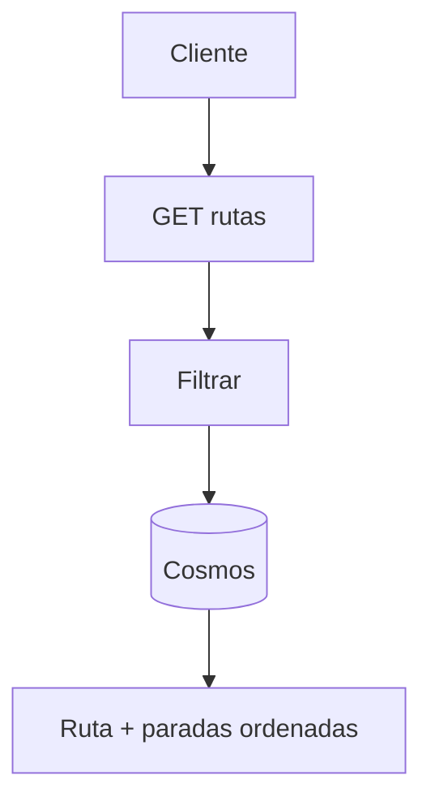
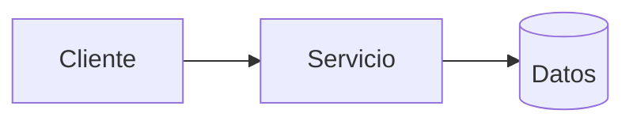
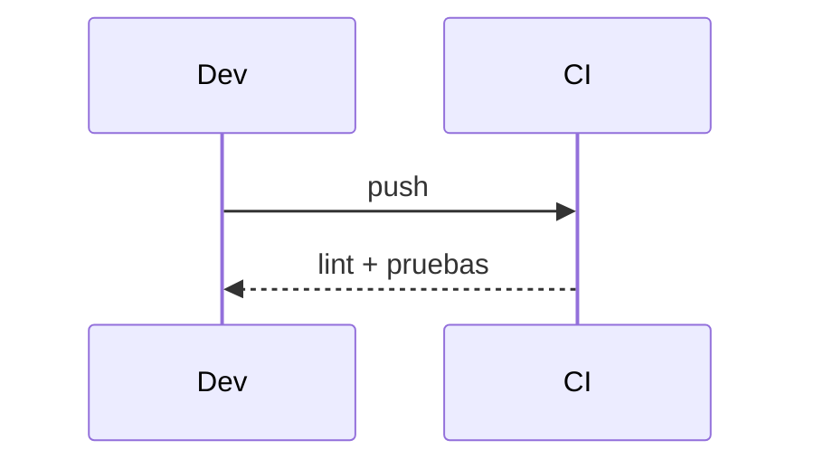

# Diagramas — 09-consulta-de-rutas-y-paradas — Consulta de rutas y paradas

> Spec: `spec.md` · Plan: `plan.md`.

## 1. Flujo funcional

## 2. Componentes

## 3. Secuencia

## 4. Notas

Diagramas de proceso; no representan recursos desplegados.
