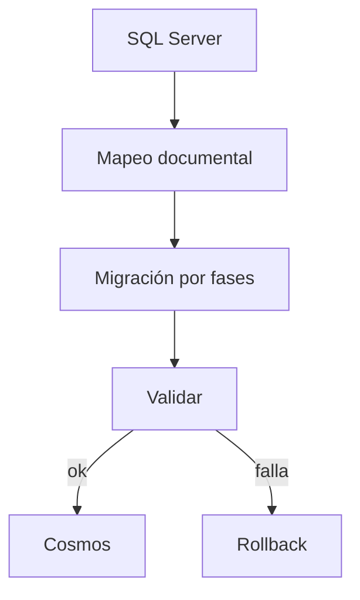
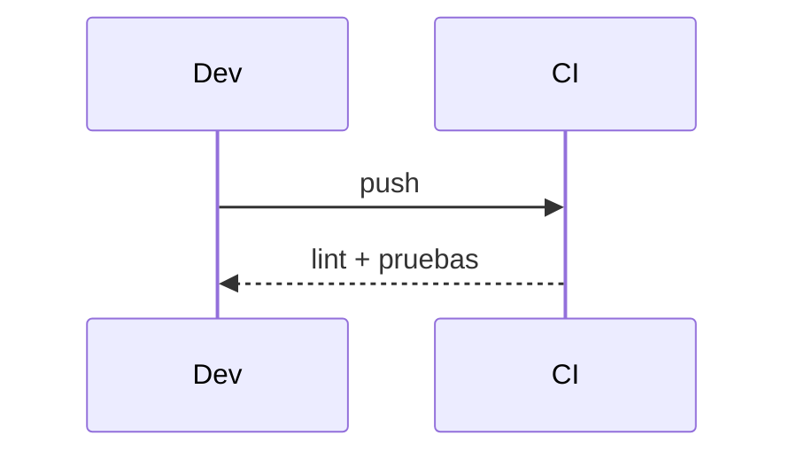

# Diagramas — 12-migracion-de-persistencia-a-cosmos-db — Migración de persistencia a Cosmos DB for NoSQL

> Spec: `spec.md` · Plan: `plan.md`.

## 1. Flujo funcional

## 2. Componentes

## 3. Secuencia

## 4. Notas

No se ha ejecutado ninguna migración.
