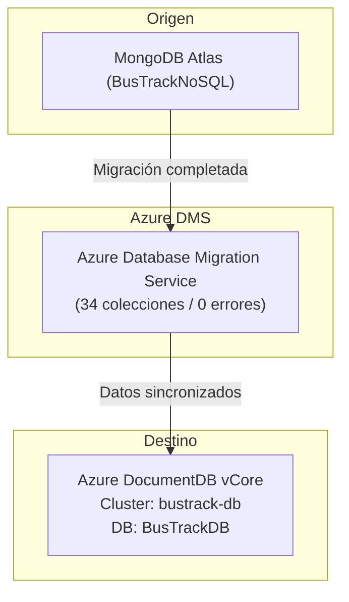
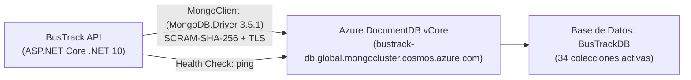
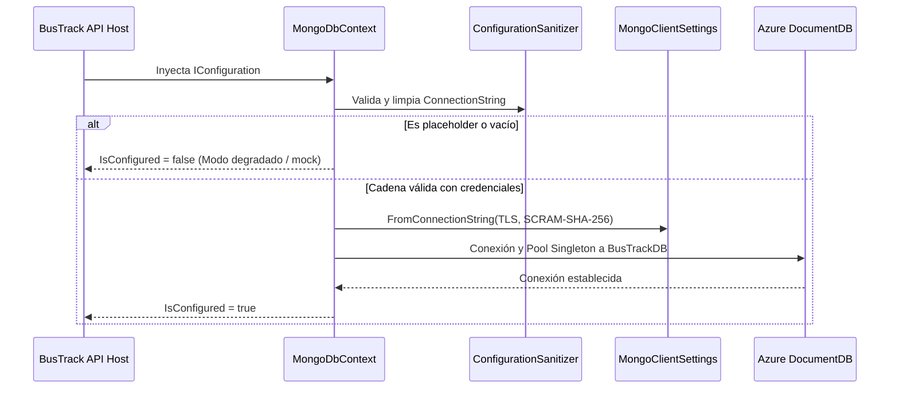

# Diagramas — 12-migracion-de-persistencia-a-cosmos-db — Conexión a Azure DocumentDB (BusTrackDB)

> Spec: `spec.md` · Plan: `plan.md` · Fecha: 2026-11-23.

## 1. Flujo de Migración de Persistencia

## 2. Arquitectura de Conexión de la API

## 3. Secuencia de Inicialización y Sanitización

